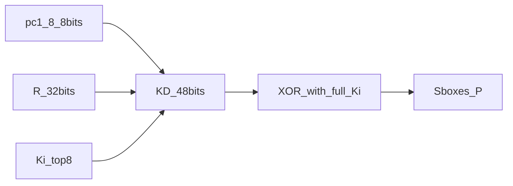

# 03 — Qué cambia en KE-DES respecto a DES

## Mensaje central

KE-DES **no reinventó** Feistel. Conserva IP, S-boxes, P, IP⁻¹ y 16 rondas. Cambia dos cosas:

1. Una transformación **Odd/Even** en el schedule de claves (tras PC-1).
2. La expansión E se sustituye por una función **K-D** que mezcla bits de clave y de datos.

El paper presenta esto como “enhancement”. El homework advierte que **no es seguro**. Tras implementar, verás por qué: Odd/Even **fija** las subclaves.

## Tabla comparativa

| Pieza | DES | KE-DES (esta implementación) |
|---|---|---|
| Bloque / rondas | 64 bits / 16 | igual |
| IP, S-boxes, P, IP⁻¹ | estándar | igual |
| Tras PC-1 | C0,D0 directos | **Odd/Even** → C0,D0 fijos (Tabla III) |
| Expansión en `f` | E (32→48) | **K-D** = pc1_8 ‖ R ‖ Ki_top8 |
| Subclaves Kᵢ | dependen de toda la clave | **idénticas** para todas las claves (post-OE) |

## Odd/Even — intuición

El Listing 1 del paper sobrescribe bits según la **posición** (impar/par), no según un secreto bien difundido. El espíritu: la salida **casi no depende** (en nuestra lectura de las tablas, **no depende**) del valor de la clave.

### Errata importante del paper

- El Listing 1 literal (56 bits → patrón uniforme `010101...`) implica `C0 == D0`.
- La **Tabla III** publica `D0 = 1010...` y la **Tabla IV** solo se reproduce con `C0=0101...`, `D0=1010...`.
- El PC-1 impreso en el paper para la clave ejemplo **no** coincide con Stallings/FIPS; nuestro PC-1 sí (ver tests).

**Decisión del proyecto:** Odd/Even implementado para cumplir **Tablas III y IV** (verdad de verificación). Documentado en `kedes/key_schedule.py`.

```text
Odd/Even → C0 = 010101... (28) || D0 = 101010... (28)
         → K1..K16 determinadas solo por shifts+PC-2 sobre ese patrón
```

### Por qué importa (seguridad)

Si `K1..K16` no dependen de la clave del usuario, el “secreto” del schedule desaparece. Queda diversidad residual en **pc1_8** (8 bits de PC-1 **antes** de Odd/Even) porque K-D los inyecta en cada ronda. Eso es ≤ 2⁸ posibilidades por ese canal, no 2⁵⁶.

Experimento: `python attacks/keyspace_odd_even.py`.

## K-D — intuición

En DES, E(R) solo mira datos. En KE-DES, el bloque de 48 bits mezcla:

- 8 bits fijos de PC-1 (`pc1_8`),
- 32 bits de R,
- 8 bits de la subclave de ronda (tras PC-2).

### Ambigüedad del paper y nuestra decisión

El paper no especifica el orden de concatenación. Adoptamos y fijamos:

```text
K-D(R, pc1_8, Ki) = pc1_8 || R_32 || Ki[0:8]
```

Código: `kedes/kd.py`. Si el profesor aclara otro orden, se cambia una función.



## Relación con el enunciado

Debes **discutir** la relación KE-DES ↔ DES: misma columna vertebral Feistel; diferencias concentradas en schedule y expansión; la “mejora” de clave, mal diseñada, **empeora** la seguridad.

## Errores comunes

- Implementar solo DES y renombrarlo.
- Aplicar Odd/Even pero seguir usando E.
- No documentar el orden K-D.

## Siguiente

[04_walkthrough_implementacion.md](04_walkthrough_implementacion.md)
